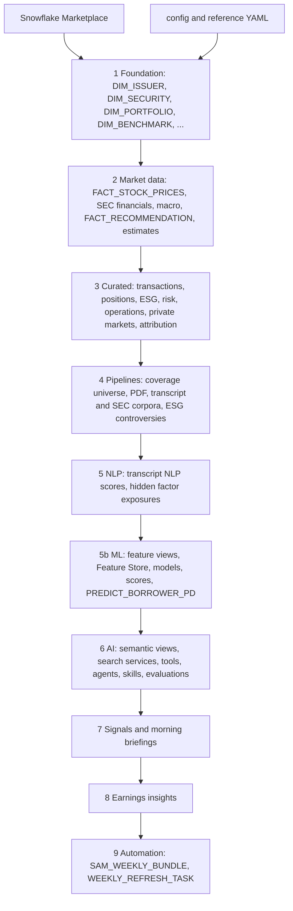
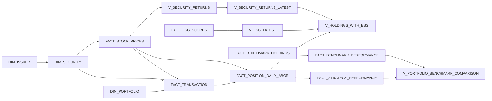
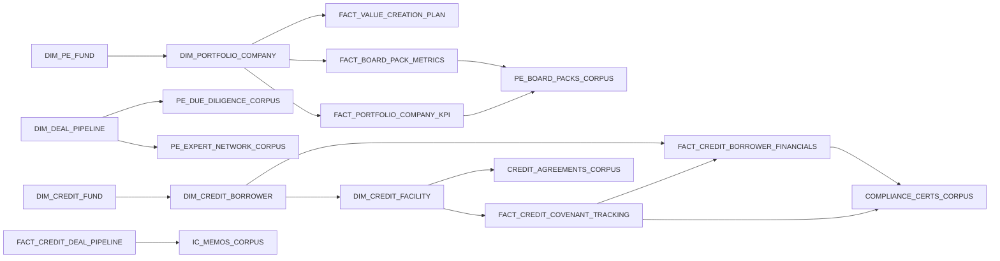
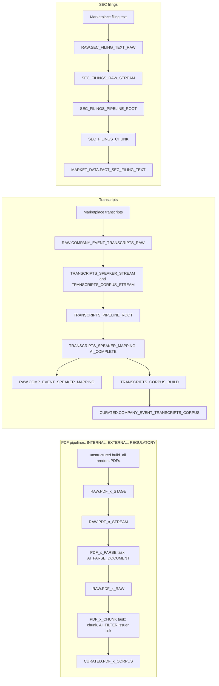
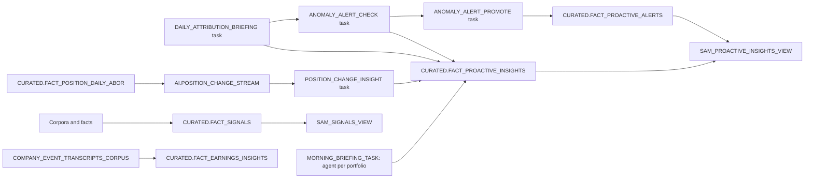

# SAM Demo - Data Lineage

This document traces how data moves through the build: from the Snowflake Marketplace and generated content, through the curated model, document pipelines and ML models, to the semantic views, search services, tools and agents. It is derived from the build code; object definitions and columns are in [`docs/data_model.md`](data_model.md).

---

## 1. Sources

| Source | What it provides | Lands in |
|---|---|---|
| Snowflake Marketplace (`REAL_DATA_SOURCES` in `python/config.py`, tables in `data/reference_data/data_sources.yaml`) | Company index, stock and ETF prices, SEC financials, segments, filing text, insider and 13F filings, N-PORT benchmark holdings, proxy compensation, policy rates, FX, economic indicators, Treasury yields, emissions, IMF fiscal data, earnings call transcripts | `CURATED.DIM_ISSUER` enrichment, `MARKET_DATA.*`, `CURATED.FACT_BENCHMARK_HOLDINGS`, `CURATED.FACT_INSIDER_TRANSACTIONS`, `CURATED.FACT_INSTITUTIONAL_HOLDINGS`, `RAW.COMPANY_EVENT_TRANSCRIPTS_RAW`, `RAW.SEC_FILING_TEXT_RAW` |
| Configuration (`python/config.py`, `data/reference_data/*.yaml`) | Issuers, portfolios, benchmarks, clients, managers, brokers, stress scenarios, private markets entities, ML settings | Dimensions and synthetic facts |
| Synthetic generation (`python/data/structured.py`, `python/data/recommendations.py`) | Transactions, ESG, risk, operations, attribution inputs, private markets facts, recommendations, private markets corpora | `CURATED.*`, some `MARKET_DATA.*` |
| Template documents (`content_library/`, `python/data/unstructured.py`) | Broker research, internal research, memos, policies, press releases, NGO reports | PDFs on `RAW.PDF_*_STAGE` |
| Regulatory PDFs (`data/reference_data/regulation_sources.yaml`) | Published regulations | `RAW.PDF_REGULATORY_STAGE` |
| Cortex AI functions | `AI_PARSE_DOCUMENT`, `AI_FILTER`, `AI_COMPLETE`, `AI_EXTRACT` enrichments | Raw tables, corpora, `FACT_DIVIDENDS`, `FACT_ESG_CONTROVERSY`, signals and insights |

Market prices anchor the build: `MARKET_DATA.FACT_STOCK_PRICES` is loaded first and its latest date sets the end date for every generated fact table.

---

## 2. Build flow

`scripts/setup.sql` creates the account objects and runs `SAM_BUILD_BUNDLE`, which executes `python/workspace_main.py`.

---

## 3. Structured dependencies

### 3.1 Core model

### 3.2 Derived tables and views

| Object | Built from |
|---|---|
| `FACT_ESG_SCORES` | `DIM_SECURITY`, `DIM_ISSUER` |
| `FACT_BENCHMARK_HOLDINGS` | `DIM_SECURITY`, marketplace N-PORT filings |
| `FACT_FACTOR_EXPOSURES` | `V_SECURITY_RETURNS`, `FACT_SEC_FINANCIALS`, `FACT_BENCHMARK_RETURNS` |
| `FACT_TAX_IMPLICATIONS` | `FACT_POSITION_DAILY_ABOR` |
| `FACT_COMPLIANCE_ALERTS` | `DIM_PORTFOLIO_IPS`, `FACT_POSITION_DAILY_ABOR` |
| `FACT_CLIENT_FLOWS`, `FACT_FUND_FLOWS` | `DIM_CLIENT`, `DIM_PORTFOLIO`; fund flows aggregate client flows |
| `FACT_TRADE_SETTLEMENT` | `FACT_TRANSACTION`, `DIM_COUNTERPARTY`, `DIM_CUSTODIAN` |
| `FACT_RECONCILIATION`, `FACT_NAV_CALCULATION`, `FACT_NAV_COMPONENTS` | `FACT_POSITION_DAILY_ABOR` |
| `FACT_CORPORATE_ACTIONS`, `FACT_CORPORATE_ACTION_IMPACT` | `DIM_SECURITY`, `FACT_DIVIDENDS`, positions |
| `FACT_CASH_MOVEMENTS`, `FACT_CASH_POSITIONS` | Transactions and flows; positions aggregate movements |
| `FACT_EXPECTED_RETURNS`, `FACT_COVARIANCE_MATRIX` | `V_SECURITY_RETURNS`, `V_SECURITY_LOG_RETURNS` |
| `V_SECURITY_LOG_RETURNS`, `V_PORTFOLIO_RISK_METRICS` | `FACT_STOCK_PRICES`; risk metrics add positions |
| `FACT_BENCHMARK_RETURNS`, `FACT_VIX_DAILY`, `FACT_SECTOR_RETURNS` | Marketplace ETF prices |
| `FACT_BRINSON_BY_SECTOR` | Positions, `FACT_BENCHMARK_SECTOR_WEIGHTS`, `FACT_SECTOR_RETURNS` |
| `FACT_BRINSON_ATTRIBUTION` | `FACT_BRINSON_BY_SECTOR` |
| `FACT_FACTOR_ATTRIBUTION` | `FACT_FACTOR_EXPOSURES`, positions |
| `FACT_BRINSON_ATTRIBUTION_DETAIL` | Positions, benchmark holdings, `V_SECURITY_RETURNS` |
| `FACT_CURRENCY_ATTRIBUTION` | Positions, `FACT_FX_RATES` |
| `FACT_BRINSON_LINKED` | `FACT_BRINSON_ATTRIBUTION_DETAIL` |
| `V_MACRO_REGIME` | `FACT_VIX_DAILY`, `FACT_BENCHMARK_RETURNS` |
| `V_REGIME_TRANSITIONS` | `V_MACRO_REGIME` |
| `V_FACTOR_ROLLING_ANALYTICS` | `FACT_FACTOR_ATTRIBUTION`, `V_MACRO_REGIME` |
| `V_ATTRIBUTION_ANOMALIES`, `V_CROSS_PORTFOLIO_ANALYTICS` | `V_FACTOR_ROLLING_ANALYTICS`, Brinson and factor attribution |
| `FACT_HISTORICAL_STRESS_PERIODS` | `FACT_VIX_DAILY`, `FACT_BENCHMARK_RETURNS` |
| `FACT_RECOMMENDATION` | `FACT_STOCK_PRICES`, `FACT_SEC_FINANCIALS`, `DIM_SECTOR_VALUATION`, `DIM_BROKER_BIAS` |
| `FACT_ESTIMATE_CONSENSUS`, `FACT_ESTIMATE_DATA` | `FACT_SEC_FINANCIALS`; estimate data adds `FACT_RECOMMENDATION`, `FACT_ANALYST_COVERAGE` |
| `FACT_TRANSCRIPT_NLP_SCORES` | `COMPANY_EVENT_TRANSCRIPTS_CORPUS`, `FACT_SEC_SEGMENTS` |
| `FACT_HIDDEN_FACTOR_EXPOSURES` | `FACT_TRANSCRIPT_NLP_SCORES`, positions |
| `FACT_ESG_CONTROVERSY` | `PDF_EXTERNAL_CORPUS` (NGO reports) |
| `DIM_COVERAGE_UNIVERSE` | `DIM_ISSUER`, holdings |

### 3.3 Private markets

The private markets corpora are written directly by `python/data/structured.py` from the facts above, so their documents always agree with the numbers.

---

## 4. Document pipelines

Created by `create_all_pipelines` and run once by `run_all_pipelines` in `python/data/pipelines.py`. After the run every pipeline task is suspended. The weekly refresh drives each graph again when new data arrives by executing the suspended root task with its child tasks resumed, so the schedules below apply only if a root task is resumed manually.

| Pipeline | Schedule | Notes |
|---|---|---|
| PDF parse tasks | Every 5 minutes, on new stage files | `AI_PARSE_DOCUMENT` in LAYOUT mode |
| PDF chunk tasks | After the parse task | 2000-character chunks with 200 overlap; `AI_FILTER` links chunks to issuers; regulatory chunks join `RAW.REGULATION_LOOKUP` |
| Transcript graph | Every 5 minutes when the stream has data | Speaker identification with `AI_COMPLETE`, then segment and chunk |
| SEC filing graph | Every 5 minutes when the stream has data | `SPLIT_TEXT_RECURSIVE_CHARACTER` chunking |

---

## 5. AI layer

### 5.1 Semantic views

All semantic views live in `SAM_DEMO.AI` and are defined in `python/ai/semantic_view_definitions/`. Several also bind `SAM_ISSUER_NAME_SEARCH` for fuzzy company name matching.

| Semantic view | Base tables |
|---|---|
| `SAM_PORTFOLIO_VIEW` | `DIM_PORTFOLIO`, `DIM_SECURITY`, `DIM_ISSUER`, `DIM_BENCHMARK`, `V_HOLDINGS_WITH_ESG`, `FACT_BENCHMARK_HOLDINGS`, `FACT_BENCHMARK_PERFORMANCE`, `V_PORTFOLIO_BENCHMARK_COMPARISON`, `FACT_FACTOR_EXPOSURES`, `FACT_COMPLIANCE_ALERTS`, `DIM_SUPPLY_CHAIN_RELATIONSHIPS`, `FACT_ESG_CONTROVERSY` |
| `SAM_ATTRIBUTION_VIEW` | `FACT_BRINSON_BY_SECTOR`, `FACT_BRINSON_ATTRIBUTION`, `FACT_BRINSON_ATTRIBUTION_DETAIL`, `FACT_BRINSON_LINKED`, `FACT_FACTOR_ATTRIBUTION`, `FACT_CURRENCY_ATTRIBUTION`, `FACT_HIDDEN_FACTOR_EXPOSURES`, `V_FACTOR_ROLLING_ANALYTICS`, `V_ATTRIBUTION_ANOMALIES`, `V_CROSS_PORTFOLIO_ANALYTICS`, `DIM_PORTFOLIO`, `DIM_SECURITY` |
| `SAM_IMPLEMENTATION_VIEW` | `FACT_POSITION_DAILY_ABOR`, `DIM_PORTFOLIO`, `DIM_SECURITY`, `DIM_CLIENT_MANDATES`, `FACT_PORTFOLIO_LIQUIDITY`, `FACT_RISK_LIMITS`, `FACT_TAX_IMPLICATIONS`, `FACT_TRADE_SETTLEMENT`, `FACT_TRADING_CALENDAR`, `FACT_TRANSACTION_COSTS` |
| `SAM_MARKET_VIEW` | `V_MACRO_REGIME`, `DIM_STRESS_SCENARIOS`, `FACT_SCENARIO_SHOCKS`, `FACT_HISTORICAL_STRESS_PERIODS`, `DIM_ISSUER`, `DIM_SECURITY`, `MARKET_DATA.FACT_TREASURY_YIELDS`, `FACT_STOCK_PRICES`, `FACT_ECONOMIC_INDICATORS`, `FACT_FX_RATES`, `FACT_POLICY_RATES`, `FACT_COUNTRY_EMISSIONS` |
| `SAM_RESEARCH_VIEW` | `DIM_ISSUER`, `FACT_RECOMMENDATION`, `FACT_INSIDER_TRANSACTIONS`, `FACT_INSTITUTIONAL_HOLDINGS`, `FACT_RESEARCH_THESES`, `MARKET_DATA.DIM_ANALYST`, `DIM_BROKER`, `FACT_ESTIMATE_DATA`, `FACT_ESTIMATE_CONSENSUS`, `FACT_SEC_FINANCIALS`, `FACT_SEC_SEGMENTS`, `FACT_EXECUTIVE_COMPENSATION` |
| `SAM_EXECUTIVE_VIEW` | `DIM_CLIENT`, `FACT_CLIENT_FLOWS`, `FACT_FUND_FLOWS`, `DIM_PORTFOLIO`, `FACT_STRATEGY_PERFORMANCE`, `DIM_PORTFOLIO_MANAGER`, `FACT_PORTFOLIO_PM_ASSIGNMENT` |
| `SAM_MIDDLE_OFFICE_VIEW` | `FACT_CASH_MOVEMENTS`, `FACT_CASH_POSITIONS`, `FACT_CORPORATE_ACTIONS`, `DIM_COUNTERPARTY`, `DIM_CUSTODIAN`, `FACT_NAV_CALCULATION`, `FACT_RECONCILIATION`, `FACT_TRADE_SETTLEMENT`, `DIM_PORTFOLIO`, `DIM_SECURITY` |
| `SAM_PORTFOLIO_MODELLING_VIEW` | `FACT_BACKTEST_RESULTS`, `FACT_EXPECTED_RETURNS`, `DIM_MODEL_PORTFOLIO`, `FACT_MODEL_PORTFOLIO_WEIGHTS`, `FACT_RISK_FACTORS`, `FACT_SIMULATION_RESULTS`, `V_SECURITY_RETURNS`, `FACT_COVARIANCE_MATRIX`, `DIM_ISSUER`, `DIM_SECURITY` |
| `SAM_TOOL_RESULTS_VIEW` | `AI.TOOL_RUN_PORTFOLIOS`, `TOOL_BACKTEST_RUNS`, `TOOL_BACKTEST_TIMESERIES`, `TOOL_SIMULATION_RUNS`, `TOOL_SIMULATION_PATHS`, `TOOL_SIMULATION_TERMINAL_VALUES` |
| `SAM_PROACTIVE_INSIGHTS_VIEW` | `FACT_PROACTIVE_INSIGHTS`, `FACT_PROACTIVE_ALERTS` |
| `SAM_SIGNALS_VIEW` | `FACT_SIGNALS` |
| `SAM_FACTOR_MODEL_VIEW` | `ML.FACT_FACTOR_RETURNS`, `FACT_FACTOR_SCORES`, `FACT_ML_FACTOR_PREDICTIONS`, `FACT_OPTIMAL_PORTFOLIO` |
| `SAM_REGIME_VIEW` | `ML.FACT_REGIME_PREDICTIONS`, `MARKET_DATA.FACT_BENCHMARK_RETURNS`, `FACT_VIX_DAILY`, `FACT_SOVEREIGN_FISCAL_OUTLOOK` |
| `SAM_CREDIT_PORTFOLIO_VIEW` | `DIM_CREDIT_BORROWER`, `DIM_CREDIT_FACILITY`, `FACT_CREDIT_COVENANT_TRACKING`, `FACT_CREDIT_BORROWER_FINANCIALS`, `FACT_CREDIT_DEAL_PIPELINE`, `MARKET_DATA.FACT_CREDIT_SECTOR_BENCHMARKS`, `FACT_SOVEREIGN_FISCAL_OUTLOOK` |
| `SAM_CREDIT_RISK_VIEW` | `DIM_CREDIT_BORROWER`, `ML.FACT_CREDIT_RISK_SCORES`, `FACT_CREDIT_SHAP_EXPLANATIONS` |
| `SAM_PE_DEAL_PIPELINE_VIEW` | `DIM_DEAL_PIPELINE` |
| `SAM_PE_VALUE_CREATION_VIEW` | `DIM_PORTFOLIO_COMPANY`, `FACT_VALUE_CREATION_PLAN`, `FACT_PORTFOLIO_COMPANY_KPI`, `FACT_BOARD_PACK_METRICS` |

Tables without a schema prefix are in `CURATED`; a prefix applies to the names that follow it in the same cell.

### 5.2 Cortex Search services

Created by `python/ai/cortex_search.py` on `SAM_DEMO_CORTEX_WH` with `snowflake-arctic-embed-m-v1.5` and a 5-minute target lag, unless stated otherwise.

| Service | Source | Search column |
|---|---|---|
| `SAM_INTERNAL_DOCS` | `CURATED.PDF_INTERNAL_CORPUS` | `DOCUMENT_TEXT` |
| `SAM_EXTERNAL_DOCS` | `CURATED.PDF_EXTERNAL_CORPUS` | `DOCUMENT_TEXT` |
| `SAM_REGULATORY_DOCS` | `CURATED.PDF_REGULATORY_CORPUS` | `DOCUMENT_TEXT` |
| `SAM_COMPANY_EVENTS` | `CURATED.COMPANY_EVENT_TRANSCRIPTS_CORPUS` | `DOCUMENT_TEXT` |
| `SAM_REAL_SEC_FILINGS` | `MARKET_DATA.FACT_SEC_FILING_TEXT` joined to `CURATED.DIM_ISSUER` | `FILING_TEXT` |
| `SAM_PE_BOARD_PACKS` | `CURATED.PE_BOARD_PACKS_CORPUS` | `DOCUMENT_TEXT` |
| `SAM_PE_DUE_DILIGENCE` | `CURATED.PE_DUE_DILIGENCE_CORPUS` | `DOCUMENT_TEXT` |
| `SAM_PE_EXPERT_NETWORK` | `CURATED.PE_EXPERT_NETWORK_CORPUS` | `DOCUMENT_TEXT` |
| `SAM_CREDIT_AGREEMENTS` | `CURATED.CREDIT_AGREEMENTS_CORPUS` | `DOCUMENT_TEXT` |
| `SAM_COMPLIANCE_CERTS` | `CURATED.COMPLIANCE_CERTS_CORPUS` | `DOCUMENT_TEXT` |
| `SAM_IC_MEMOS` | `CURATED.IC_MEMOS_CORPUS` | `DOCUMENT_TEXT` |
| `SAM_ISSUER_NAME_SEARCH` | Distinct `LEGALNAME` from `CURATED.DIM_ISSUER` | `LEGALNAME` (1-day target lag) |

### 5.3 Custom tools

| Tool | Reads | Writes |
|---|---|---|
| `EXPLAIN_DATA_ORIGIN` | Semantic view and view definitions | — |
| `GENERATE_PDF_REPORT` | — | `@AI.PDF_REPORTS` |
| `RUN_MONTE_CARLO_TOOL` (uses `SIMULATE_PATH_BATCH`) | `V_SECURITY_RETURNS`, `DIM_SECURITY` | `TOOL_RUN_PORTFOLIOS`, `TOOL_SIMULATION_RUNS`, `TOOL_SIMULATION_PATHS`, `TOOL_SIMULATION_TERMINAL_VALUES` |
| `RUN_BACKTEST_TOOL` | `V_SECURITY_RETURNS`, `DIM_SECURITY` | `TOOL_RUN_PORTFOLIOS`, `TOOL_BACKTEST_RUNS`, `TOOL_BACKTEST_TIMESERIES` |
| `RUN_ATTRIBUTION_TOOL` | `DIM_PORTFOLIO`, `DIM_BENCHMARK`, `FACT_POSITION_DAILY_ABOR`, `FACT_BENCHMARK_HOLDINGS`, `DIM_SECURITY`, `DIM_ISSUER`, `FACT_STOCK_PRICES` | — |
| `RUN_STRESS_BACKTEST_TOOL` | `FACT_HISTORICAL_STRESS_PERIODS`, `FACT_FACTOR_ATTRIBUTION`, `FACT_SCENARIO_SHOCKS` | — |
| `RUN_SCENARIO_SENSITIVITY_TOOL` | `DIM_STRESS_SCENARIOS`, `FACT_SCENARIO_SHOCKS`, factor attribution | — |
| `RUN_COUNTERFACTUAL_ANALYSIS` | `DIM_PORTFOLIO`, `FACT_BRINSON_ATTRIBUTION_DETAIL` | — |
| `SP_UPSERT_RESEARCH_THESIS` | `FACT_RESEARCH_THESES` | `FACT_RESEARCH_THESES` |
| `MA_SIMULATION_TOOL` (uses `MA_SIMULATION_ENGINE`) | `FACT_POSITION_DAILY_ABOR` | — |
| `PREDICT_BORROWER_PD` | `DIM_CREDIT_BORROWER`, `ML."CREDIT_RISK_FEATURES$BUILD"`, model `ML.CREDIT_RISK_XGBOOST` (`PRODUCTION`) | — |

### 5.4 Agents

Every agent also has the built-in `server_skill`, `code_execution` and `data_to_chart` tools. Skills are loaded from `@AI.SKILL_STAGE`.

| Agent | Semantic views | Search services | Custom tools |
|---|---|---|---|
| `AM_portfolio_management_copilot` | PORTFOLIO, IMPLEMENTATION, ATTRIBUTION, MARKET, PROACTIVE_INSIGHTS, SIGNALS, RESEARCH, FACTOR_MODEL, REGIME, PORTFOLIO_MODELLING, TOOL_RESULTS | COMPANY_EVENTS, REAL_SEC_FILINGS, EXTERNAL_DOCS, INTERNAL_DOCS | `GENERATE_PDF_REPORT`, `EXPLAIN_DATA_ORIGIN`, `RUN_COUNTERFACTUAL_ANALYSIS`, `RUN_STRESS_BACKTEST_TOOL`, `RUN_SCENARIO_SENSITIVITY_TOOL`, `RUN_BACKTEST_TOOL`, `RUN_MONTE_CARLO_TOOL`, `RUN_ATTRIBUTION_TOOL` |
| `AM_research_copilot` | RESEARCH | EXTERNAL_DOCS, COMPANY_EVENTS, REAL_SEC_FILINGS | `GENERATE_PDF_REPORT`, `SP_UPSERT_RESEARCH_THESIS` |
| `AM_risk_compliance_copilot` | PORTFOLIO, RESEARCH, MARKET | REAL_SEC_FILINGS, REGULATORY_DOCS, EXTERNAL_DOCS, INTERNAL_DOCS, COMPANY_EVENTS | `GENERATE_PDF_REPORT` |
| `AM_client_advisory_copilot` | PORTFOLIO, EXECUTIVE, RESEARCH, ATTRIBUTION | INTERNAL_DOCS, REGULATORY_DOCS | `GENERATE_PDF_REPORT` |
| `AM_operations_copilot` | MIDDLE_OFFICE | INTERNAL_DOCS | `GENERATE_PDF_REPORT` |
| `AM_executive_leadership_copilot` | EXECUTIVE, PORTFOLIO, RESEARCH, ATTRIBUTION, IMPLEMENTATION | INTERNAL_DOCS, EXTERNAL_DOCS | `MA_SIMULATION_TOOL`, `GENERATE_PDF_REPORT`, `EXPLAIN_DATA_ORIGIN` |
| `AM_private_equity_copilot` | PE_DEAL_PIPELINE, PE_VALUE_CREATION, RESEARCH | REAL_SEC_FILINGS, PE_DUE_DILIGENCE, PE_BOARD_PACKS, PE_EXPERT_NETWORK | — |
| `AM_private_credit_copilot` | CREDIT_PORTFOLIO, CREDIT_RISK, MARKET, RESEARCH | CREDIT_AGREEMENTS, COMPLIANCE_CERTS, IC_MEMOS, REAL_SEC_FILINGS | `PREDICT_BORROWER_PD` |

View names omit the `SAM_` prefix and `_VIEW` suffix; service names omit the `SAM_` prefix.

### 5.5 Proactive insights and signals

The proactive tasks are created suspended; build steps 7 and 8 seed `FACT_SIGNALS`, `FACT_PROACTIVE_INSIGHTS` and `FACT_EARNINGS_INSIGHTS` directly.

---

## 6. ML lineage

```mermaid
flowchart LR
    VIX[MARKET_DATA.FACT_VIX_DAILY] --> VRF[ML.V_REGIME_FEATURES]
    BR[MARKET_DATA.FACT_BENCHMARK_RETURNS] --> VRF
    SR[MARKET_DATA.FACT_SECTOR_RETURNS] --> VRF
    VRF --> FVR[Feature view REGIME_FEATURES/BUILD]
    FVR --> DSR[Dataset REGIME_TRAINING_DS]
    DSR --> MRG[Model MARKET_REGIME_GMM PRODUCTION]
    FVR --> SCR[score_regime]
    MRG --> SCR
    SCR --> FRP[ML.FACT_REGIME_PREDICTIONS]
    FIN[CURATED.FACT_CREDIT_BORROWER_FINANCIALS] --> VCF[ML.V_CREDIT_RISK_FEATURES]
    COV[CURATED.FACT_CREDIT_COVENANT_TRACKING] --> VCF
    BOR[CURATED.DIM_CREDIT_BORROWER] --> VCF
    FRP --> VCF
    COV --> VCL[ML.V_CREDIT_RISK_LABELS]
    VCF --> FVC[Feature view CREDIT_RISK_FEATURES/BUILD]
    FVC --> DSC[Dataset CREDIT_RISK_TRAINING_DS]
    VCL --> DSC
    DSC --> MCX[Model CREDIT_RISK_XGBOOST PRODUCTION]
    FVC --> SCC[score_credit_risk]
    MCX --> SCC
    SCC --> FCS[ML.FACT_CREDIT_RISK_SCORES]
    SCC --> FSH[ML.FACT_CREDIT_SHAP_EXPLANATIONS]
    FVC --> PBP[AI.PREDICT_BORROWER_PD]
    MCX --> PBP
```

- The regime predictions feed the credit features (the regime at each quarter end), so the regime model is always scored before the credit model.
- Training datasets are generated from the feature views with `generate_dataset` and a point-in-time check; the Model Registry records lineage from each model version to its dataset and feature views.
- `_promote` moves the `PRODUCTION` alias to the new version and makes it the default; scoring and `PREDICT_BORROWER_PD` always use `PRODUCTION`.
- `PREDICT_BORROWER_PD` takes a borrower name and optional overrides (absolute, `+`/`-` or `%` changes), propagates leverage and coverage changes into covenant headroom, and returns the baseline and stressed probability with `EXPLAIN` drivers.
- The factor tables `FACT_FACTOR_SCORES` and `FACT_ML_FACTOR_PREDICTIONS` are filled by the `factor_discovery` notebook. `FACT_FACTOR_RETURNS` and `FACT_OPTIMAL_PORTFOLIO` are derived from them by `python/ai/tools/factor_engine.py` once they contain rows.

---

## 7. Weekly refresh

`AI.WEEKLY_REFRESH_TASK` runs every Monday at 06:00 UTC and executes `SAM_WEEKLY_BUNDLE` with `python/weekly_refresh_main.py --mode weekly`, which calls `run()` in `python/data/weekly_refresh.py`. The window starts the day after the watermark in `FSI_DEMO_CONFIG.APP.REFRESH_STATE` and ends at the latest marketplace price date.

| Step | Function | Writes |
|---|---|---|
| 0 Window | `cadence.get_watermark`, `incremental.get_source_max_price_date` | — |
| 1 Prices | `incremental.append_stock_prices` | `FACT_STOCK_PRICES` |
| 2 Structured | `incremental.refresh_structured` | `FACT_TRANSACTION`, `FACT_POSITION_DAILY_ABOR`, `FACT_FACTOR_EXPOSURES`, `FACT_VIX_DAILY`, `FACT_BENCHMARK_RETURNS`, `FACT_SECTOR_RETURNS`, Brinson tables, `FACT_STRATEGY_PERFORMANCE`, `FACT_COVARIANCE_MATRIX`, middle office facts |
| 3 Private markets | `private_markets.refresh_private_markets` (quarterly cadence) | PE KPIs and board packs, `FACT_CREDIT_BORROWER_FINANCIALS`, `FACT_CREDIT_COVENANT_TRACKING` |
| 3b ML | `ml_models.score_ml_models` (rescore with `PRODUCTION`, no retraining) | `FACT_REGIME_PREDICTIONS`, `FACT_CREDIT_RISK_SCORES`, `FACT_CREDIT_SHAP_EXPLANATIONS` |
| 4 Marketplace corpora | `transcripts.load_raw_table`, `load_sec_filings_raw`, transcript and SEC task graphs | `COMPANY_EVENT_TRANSCRIPTS_CORPUS`, `FACT_SEC_FILING_TEXT` |
| 5 Recommendations | `recommendations.ensure_vintage`, `market_data.build_estimate_data` | `FACT_RECOMMENDATION`, estimates |
| 5b Coverage gaps | `backfill_coverage_gaps` | Documents and recommendations for names new to `DIM_COVERAGE_UNIVERSE` |
| 6 Due documents | `_evaluate_due_documents` | — |
| 7 Generate documents | `_generate_documents`, `_log_generated_vintages` | PDFs, `RAW.DOCUMENT_VINTAGE_LOG` |
| 8 Document pipelines | `_run_document_pipelines` | `PDF_*_RAW`, `PDF_*_CORPUS` |
| 8b ESG controversies | `structured.build_fact_esg_controversy` | `FACT_ESG_CONTROVERSY` |
| 9 Briefings | `seed_morning_briefings` (7-day expiry) | `FACT_PROACTIVE_INSIGHTS` |
| 10 Prune | `prune_expired_insights` | Deletes expired insights and alerts |
| 11 Watermark | `cadence.set_watermark` | `REFRESH_STATE`: `SUCCESS`, `PARTIAL` or `FAILED` |

Search services pick up corpus changes through their target lag, and semantic views read the refreshed tables directly, so no AI object is rebuilt by the refresh.

---

## Related documentation

- [`docs/data_model.md`](data_model.md) - Objects, columns and builders
