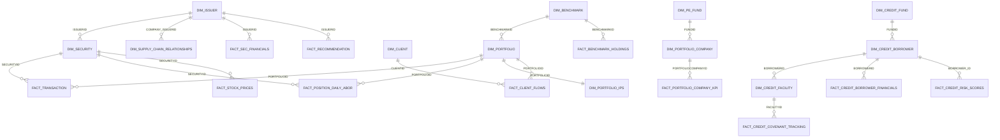

# SAM Demo - Data Model

This document lists every database object the build creates for Simulated Asset Management (SAM). It is derived from the build code in `python/` and `scripts/setup.sql`; each table names the function that creates the object. Data flows, dependencies and the weekly refresh are described in [`docs/data_lineage.md`](data_lineage.md).

Object names are as Snowflake stores them (uppercase). Row counts are not listed because the weekly refresh extends most fact tables.

---

## 1. Overview

### 1.1 Databases and schemas

| Database / schema | Contents | Created by |
|---|---|---|
| `SAM_DEMO.RAW` | Document stages, raw document tables, streams and pipeline tasks, document vintage log | `scripts/setup.sql`, `python/data/pipelines.py` |
| `SAM_DEMO.CURATED` | Dimension and fact model, analytics views, document corpora, signals and insights | `python/data/structured.py`, `python/data/market_data.py`, `python/ai/*` |
| `SAM_DEMO.MARKET_DATA` | Market and reference data sourced from the Snowflake Marketplace, plus derived NLP scores | `python/data/market_data.py`, `python/data/structured.py` |
| `SAM_DEMO.ML` | Feature views, Feature Store entities and feature views, training datasets, registered models, model output tables | `python/ai/tools/ml_models.py` |
| `SAM_DEMO.AI` | Semantic views, Cortex Search services, custom tools, agents, tool result tables, stages, tasks and Code Bundles | `python/ai/builder.py`, `python/data/automation.py` |
| `FSI_DEMO_CONFIG.APP` | `REFRESH_STATE` (weekly refresh watermark) | `python/data/cadence.py` |
| `SNOWFLAKE_PUBLIC_DATA_FREE` | Snowflake Public Data (Free) Marketplace listing, the source for all real market data | `scripts/setup.sql` |

The marketplace database and schema are configured in `REAL_DATA_SOURCES` in `python/config.py`; source table names are listed in `data/reference_data/data_sources.yaml`.

### 1.2 Account-level objects

| Object | Type | Details |
|---|---|---|
| `SAM_DEMO_EXECUTION_WH` | Warehouse | LARGE. Build, agent tools and tasks |
| `SAM_DEMO_CORTEX_WH` | Warehouse | MEDIUM. Cortex Search services |
| `SAM_DEMO_BUNDLE_POOL` | Compute pool | 1 node, `GEN_X64_G2_4`. Runs both Code Bundles |
| `SAM_DEMO_ML_POOL` | Compute pool | 1 node, `MEM_X64_G2_8`. ML notebooks |
| `FSI_DEMO_BUILD_ROLE` | Role | Owns and builds all objects |
| `SAM_DEMO_USER_ROLE` | Role | Runtime role for agents and notebooks |

### 1.3 Build steps

`python/workspace_main.py` builds the objects in this order. `--scope` selects a subset (`all`, `data`, `ml`, `ai`, `semantic`, `search`, `agents`, `signals`, `morning-brief`, `earnings-insights`, `automation`).

| Step | Scope | What is created |
|---|---|---|
| 1 Foundation | data | Database, schemas, core dimensions |
| 2 Market data | data | `MARKET_DATA` tables, `FACT_RECOMMENDATION`, insider and institutional holdings |
| 3 Curated | data | Positions, transactions, ESG, risk, operations, private markets, attribution, modelling views |
| 4 Pipelines | data | Coverage universe, document pipelines and corpora, ESG controversies |
| 5 NLP | data | Transcript NLP scores, hidden factor exposures |
| 5b ML | data, ml | Feature views, Feature Store, trained models, model output tables, `PREDICT_BORROWER_PD` |
| 6 AI | ai, semantic, search, agents | Insight, signal and thesis tables, semantic views, search services, tools, agents, skills, evaluation datasets, proactive tasks |
| 7 Signals and briefings | signals, morning-brief | Seeded `FACT_SIGNALS` and `FACT_PROACTIVE_INSIGHTS` |
| 8 Earnings | earnings-insights | `FACT_EARNINGS_INSIGHTS` |
| 9 Automation | data, automation | `CODE_BUNDLE_STAGE`, `SAM_WEEKLY_BUNDLE`, `WEEKLY_REFRESH_TASK` |

---

## 2. CURATED schema

Unless stated otherwise, builders are in `python/data/structured.py`.

### 2.1 Dimensions

| Object | Type | Purpose | Key columns | Builder |
|---|---|---|---|---|
| `DIM_ISSUER` | Table | Issuer master, drives the whole build | PK `ISSUERID`; `ULTIMATEPARENTISSUERID`, `CIK`, `PRIMARYTICKER`, `LEGALNAME`, `GICS_SECTOR`, `TIER` | `build_dim_issuer` |
| `DIM_SECURITY` | Table | One security per issuer | PK `SECURITYID`; FK `ISSUERID`; `TICKER`, `FIGI`, `ASSETCLASS`, `ISACTIVE` | `build_dim_security` |
| `DIM_PORTFOLIO` | Table | SAM portfolios | PK `PORTFOLIOID`; FK `BENCHMARKID`; `PORTFOLIONAME`, `STRATEGY`, `BASECURRENCY` | `build_dim_portfolio` |
| `DIM_PORTFOLIO_MANAGER` | Table | Portfolio manager roster | PK `PM_ID`; `PM_NAME`, `TEAM`, `AUM_CAPACITY` | `build_dim_portfolio_manager` |
| `FACT_PORTFOLIO_PM_ASSIGNMENT` | Table | Portfolio to manager assignment | FKs `PORTFOLIOID`, `PM_ID` | `build_dim_portfolio_manager` |
| `DIM_BENCHMARK` | Table | Benchmarks | PK `BENCHMARKID`; `BENCHMARKNAME`, `PROVIDER` | `build_dim_benchmark` |
| `DIM_PORTFOLIO_IPS` | Table | Investment policy limits per portfolio | PK `IPSID`; FK `PORTFOLIOID`; `EQUITYTARGETPCT`, `MAXSINGLEISSUERPCT`, `MAXSECTORPCT`, `MAXDRAWDOWNPCT` | `build_dim_portfolio_ips` |
| `DIM_SUPPLY_CHAIN_RELATIONSHIPS` | Table | Supplier and customer links between issuers | PK `RELATIONSHIPID`; FKs `COMPANY_ISSUERID`, `COUNTERPARTY_ISSUERID`; `COSTSHARE`, `REVENUESHARE`, `CRITICALITYTIER` | `build_dim_supply_chain_relationships` |
| `DIM_COUNTERPARTY` | Table | Trade counterparties | PK `COUNTERPARTYID`; `HISTORICALFAILRATE`, `AVERAGESETTLEMENTTIME`, `RISKRATING` | `build_dim_counterparty` |
| `DIM_CUSTODIAN` | Table | Custodians | PK `CUSTODIANID`; `CUSTODIANTYPE`, `SERVICELEVEL` | `build_dim_custodian` |
| `DIM_CLIENT` | Table | Institutional clients | PK `CLIENTID`; `CLIENTTYPE`, `REGION`, `AUM_WITH_SAM`, `ACCOUNTSTATUS` | `build_dim_client` |
| `DIM_CLIENT_MANDATES` | Table | Mandate constraints per portfolio | FK `PORTFOLIOID`; `POSITION_CHANGE_APPROVAL_THRESHOLD_PCT`, `MIN_ESG_RATING`, `MAX_REBALANCING_FREQUENCY_DAYS` | `build_client_mandate_data` |
| `DIM_MODEL_PORTFOLIO` | Table | Model portfolios | PK `MODELPORTFOLIOID`; FK `BENCHMARKID`; `STRATEGY`, `REBALANCEFREQUENCY` | `build_dim_model_portfolio` |
| `DIM_STRESS_SCENARIOS` | Table | Stress scenario catalogue | PK `SCENARIO_ID`; `SCENARIO_TYPE`, `SEVERITY`, `HISTORICAL_REFERENCE` | `build_attribution_tables` |
| `DIM_COVERAGE_UNIVERSE` | Table | Research coverage universe that drives document generation | FK `ISSUERID`; `TICKER`, `GICS_SECTOR`, `ADDED_AT` | `python/data/coverage_universe.py:build_coverage_universe` |
| `DIM_SECTOR_VALUATION` | Table | Sector P/E multiples for fair value | PK `GICS_SECTOR`; `BASEPE`, `DEFAULTPE` | `python/data/recommendations.py:build_dim_sector_valuation` |
| `DIM_BROKER_BIAS` | Table | Persistent valuation tilt per broker | PK `BROKERNAME`; `BIASPCT`, `JITTERHALFWIDTHPCT` | `python/data/recommendations.py:build_dim_broker_bias` |

### 2.2 Positions, transactions, ESG, factors and benchmarks

| Object | Type | Purpose | Key columns | Builder |
|---|---|---|---|---|
| `FACT_TRANSACTION` | Table | Trade ledger, the source of truth for positions | PK `TRANSACTIONID`; FKs `PORTFOLIOID`, `SECURITYID`; `TRADEDATE`, `QUANTITY`, `PRICE`, `GROSSAMOUNT_LOCAL` | `build_fact_transaction` |
| `FACT_POSITION_DAILY_ABOR` | Table | Month-end ABOR holdings | PK (`HOLDINGDATE`, `PORTFOLIOID`, `SECURITYID`); `QUANTITY`, `MARKETVALUE_BASE`, `COSTBASIS_BASE`, `PORTFOLIOWEIGHT` | `build_fact_position_daily_abor` |
| `FACT_ESG_SCORES` | Table | ESG scores per security | FK `SECURITYID`; `SCORE_DATE`, `SCORE_TYPE`, `SCORE_VALUE`, `SCORE_GRADE` | `build_esg_scores` |
| `FACT_ESG_CONTROVERSY` | Table | Controversies extracted from NGO reports | FKs `SECURITYID`, `ISSUERID`; `SEVERITY`, `CATEGORY`, `REPORTDATE`, `ISACTIVE` | `build_fact_esg_controversy` |
| `V_ESG_LATEST` | View | Latest ESG score per security | `SECURITYID`; `ESG_SCORE`, `ESG_GRADE`, `ESG_SCORE_DATE` | `build_v_esg_latest` |
| `V_HOLDINGS_WITH_ESG` | View | Holdings with ESG and returns | `PORTFOLIOID`, `SECURITYID`, `HOLDINGDATE`; `MARKETVALUE_BASE`, `ESG_SCORE`, `YTD_RETURN_PCT` | `build_v_holdings_with_esg` |
| `V_SECURITY_RETURNS` | View | Daily, MTD, QTD and YTD returns | `SECURITYID`, `PRICE_DATE`; `PRICE_CLOSE`, `DAILY_RETURN_PCT`, `YTD_RETURN_PCT` | `build_security_returns_view` |
| `V_SECURITY_RETURNS_LATEST` | View | Latest return snapshot | `SECURITYID`; `RETURNS_DATE`, `LATEST_PRICE`, `MTD_RETURN_PCT` | `build_security_returns_view` |
| `V_SECURITY_LOG_RETURNS` | View | Log returns over several horizons | `SECURITYID`, `PRICE_DATE`; `LOG_RETURN_DAILY`, `LOG_RETURN_21D`, `LOG_RETURN_252D` | `build_portfolio_modelling_views` |
| `FACT_FACTOR_EXPOSURES` | Table | Factor betas per security | `SECURITYID`, `EXPOSURE_DATE`, `FACTOR_NAME`; `EXPOSURE_VALUE`, `R_SQUARED` | `build_factor_exposures` |
| `FACT_BENCHMARK_HOLDINGS` | Table | Benchmark constituents (from SEC N-PORT) | FKs `BENCHMARKID`, `SECURITYID`; `HOLDING_DATE`, `BENCHMARK_WEIGHT`, `MARKET_VALUE_USD` | `build_benchmark_holdings` |
| `FACT_BENCHMARK_PERFORMANCE` | Table | Benchmark MTD, QTD and YTD returns | PK `BENCHMARKPERFID`; FK `BENCHMARKID`; `PERFORMANCEDATE`, `YTD_RETURN_PCT` | `build_fact_benchmark_performance` |
| `FACT_STRATEGY_PERFORMANCE` | Table | Portfolio AUM and returns by month | PK `STRATEGYPERFID`; FK `PORTFOLIOID`; `STRATEGY_AUM`, `STRATEGY_MTD_RETURN`, `STRATEGY_YTD_RETURN` | `build_fact_strategy_performance` |
| `V_PORTFOLIO_BENCHMARK_COMPARISON` | View | Portfolio vs benchmark active returns | `PORTFOLIOID`, `BENCHMARKID`, `PERFORMANCEDATE`; `ACTIVE_MTD_RETURN`, `ACTIVE_YTD_RETURN`, `PORTFOLIO_AUM` | `build_portfolio_benchmark_comparison_view` |

### 2.3 Risk, compliance, implementation and portfolio modelling

| Object | Type | Purpose | Key columns | Builder |
|---|---|---|---|---|
| `V_PORTFOLIO_RISK_METRICS` | View | Volatility, drawdown and Sharpe per portfolio | `PORTFOLIOID`, `HOLDINGDATE`; `VOLATILITY_21D_ANN`, `CURRENTDRAWDOWN`, `SHARPE_21D_APPROX` | `build_portfolio_modelling_views` |
| `FACT_TRANSACTION_COSTS` | Table | Spread, volume and market impact | `SECURITYID`, `COST_DATE`; `BID_ASK_SPREAD_BPS`, `AVG_DAILY_VOLUME_M`, `MARKET_IMPACT_BPS_PER_1M` | `build_transaction_cost_data` |
| `FACT_PORTFOLIO_LIQUIDITY` | Table | Cash and liquidity score | `PORTFOLIOID`, `LIQUIDITY_DATE`; `CASH_POSITION_USD`, `PORTFOLIO_LIQUIDITY_SCORE` | `build_liquidity_data` |
| `FACT_RISK_LIMITS` | Table | Tracking error, VaR and concentration limits | `PORTFOLIOID`, `LIMITS_DATE`; `TRACKING_ERROR_LIMIT_PCT`, `CURRENT_TRACKING_ERROR_PCT`, `VAR_LIMIT_1DAY_PCT` | `build_risk_budget_data` |
| `FACT_TRADING_CALENDAR` | Table | Earnings, blackout and options-expiry events | `SECURITYID`, `EVENT_DATE`, `EVENT_TYPE`; `IS_BLACKOUT_PERIOD`, `EXPECTED_VIX_LEVEL` | `build_trading_calendar_data` |
| `FACT_TAX_IMPLICATIONS` | Table | Unrealised gains and tax-loss harvesting flags | `PORTFOLIOID`, `SECURITYID`, `TAX_DATE`; `UNREALIZED_GAIN_LOSS_USD`, `TAX_LOSS_HARVEST_OPPORTUNITY` | `build_tax_implications_data` |
| `FACT_COMPLIANCE_ALERTS` | Table | IPS and concentration breaches | PK `ALERTID`; FKs `PORTFOLIOID`, `SECURITYID`; `ALERTTYPE`, `ALERTSEVERITY`, `IPSLIMITVALUE`, `IPSCURRENTVALUE` | `build_fact_compliance_alerts` |
| `FACT_PRE_SCREENED_REPLACEMENTS` | Table | Eligible replacement securities | `PORTFOLIOID`, `SECURITYID`, `SCREENDATE`; `REPLACEMENTRANK`, `ESG_GRADE`, `AI_GROWTH_SCORE` | `build_fact_pre_screened_replacements` |
| `FACT_MODEL_PORTFOLIO_WEIGHTS` | Table | Target weights for model portfolios | PK `WEIGHTID`; FKs `MODELPORTFOLIOID`, `SECURITYID`; `TARGETWEIGHT`, `MINWEIGHT`, `MAXWEIGHT` | `build_fact_model_portfolio_weights` |
| `FACT_RISK_FACTORS` | Table | Fama-French style factor returns | PK `FACTORID`; `FACTORDATE`, `MKT_RF`, `SMB`, `HML`, `MOM` | `build_fact_risk_factors` |
| `FACT_EXPECTED_RETURNS` | Table | Capital market assumptions per security | PK `ESTIMATEID`; FK `SECURITYID`; `HORIZONMONTHS`, `EXPECTEDRETURN_ANNUALIZED`, `EXPECTEDRETURN_LOW`, `EXPECTEDRETURN_HIGH` | `build_fact_expected_returns` |
| `FACT_COVARIANCE_MATRIX` | Table | Pairwise covariance and correlation | PK `COVARIANCEID`; `SECURITYID_ROW`, `SECURITYID_COL`; `COVARIANCE_ANNUALIZED`, `CORRELATION` | `build_fact_covariance_matrix` |
| `FACT_BACKTEST_RESULTS` | Table | Backtest output scaffold (created empty) | PK `BACKTESTID`; FKs `MODELPORTFOLIOID`, `PORTFOLIOID`; `CUMULATIVERETURN`, `SHARPERATIO`, `MAXDRAWDOWN` | `build_fact_backtest_results` |
| `FACT_SIMULATION_RESULTS` | Table | Monte Carlo output scaffold (created empty) | PK `SIMULATIONID`; FK `MODELPORTFOLIOID`; `PORTFOLIOVALUE`, `PERCENTILE_5`, `MEDIAN`, `PROBLOSS` | `build_fact_simulation_results` |
| `FACT_SCENARIO_SHOCKS` | Table | Factor shocks per stress scenario | FK `SCENARIO_ID`; `FACTOR_NAME`, `FACTOR_SHOCK`, `CONFIDENCE_LEVEL` | `build_attribution_tables` |
| `FACT_HISTORICAL_STRESS_PERIODS` | Table | Historical stress episodes | PK `PERIOD_ID`; FK `LINKED_SCENARIO_ID`; `MARKET_RETURN`, `PEAK_VIX` | `build_attribution_tables` |
| `FACT_HIDDEN_FACTOR_EXPOSURES` | Table | AI and geopolitical exposures from transcript NLP | `PORTFOLIOID`, `DATE`, `FACTOR_NAME`; `FACTOR_EXPOSURE`, `EXPLANATORY_POWER` | `build_hidden_factor_exposures` |
| `V_MACRO_REGIME` | View | Volatility and market regime per day | `DATE`; `VIX_CLOSE`, `SPX_RETURN`, `VOLATILITY_REGIME`, `MARKET_REGIME` | `build_attribution_tables` |
| `V_REGIME_TRANSITIONS` | View | Dates when the regime changed | `TRANSITION_DATE`; `FROM_VOL_REGIME`, `TO_VOL_REGIME`, `DAYS_IN_PRIOR_REGIME` | `build_advanced_attribution_views` |

### 2.4 Clients and flows

| Object | Type | Purpose | Key columns | Builder |
|---|---|---|---|---|
| `FACT_CLIENT_FLOWS` | Table | Client subscriptions and redemptions | PK `FLOWID`; FKs `CLIENTID`, `PORTFOLIOID`; `FLOWDATE`, `FLOWTYPE`, `FLOWAMOUNT` | `build_fact_client_flows` |
| `FACT_FUND_FLOWS` | Table | Gross and net flows per portfolio | PK `FUNDFLOWID`; FK `PORTFOLIOID`; `GROSSINFLOWS`, `GROSSOUTFLOWS`, `NETFLOWS` | `build_fact_fund_flows` |

### 2.5 Attribution

| Object | Type | Purpose | Key columns | Builder |
|---|---|---|---|---|
| `FACT_BRINSON_BY_SECTOR` | Table | Sector Brinson effects | `DATE`, `PORTFOLIOID`, `SECTOR`; `ALLOCATION_EFFECT`, `SELECTION_EFFECT`, `INTERACTION_EFFECT` | `build_attribution_tables` |
| `FACT_BRINSON_ATTRIBUTION` | Table | Portfolio Brinson totals | `DATE`, `PORTFOLIOID`; `ACTIVE_RETURN`, `ALLOCATION_EFFECT`, `SELECTION_EFFECT` | `build_attribution_tables` |
| `FACT_FACTOR_ATTRIBUTION` | Table | Factor contribution to return | `DATE`, `PORTFOLIOID`, `FACTOR_NAME`; `PORTFOLIO_FACTOR_EXPOSURE`, `FACTOR_RETURN`, `FACTOR_CONTRIBUTION` | `build_attribution_tables` |
| `FACT_BRINSON_ATTRIBUTION_DETAIL` | Table | Multi-level Brinson by grouping dimension | `DATE`, `PORTFOLIOID`, `GROUPINGDIMENSION`, `GROUPINGVALUE`; `ALLOCATIONEFFECT`, `SELECTIONEFFECT`, `TOTALEFFECT` | `build_multi_level_attribution` |
| `FACT_CURRENCY_ATTRIBUTION` | Table | Local, FX and base return decomposition | `DATE`, `PORTFOLIOID`, `SECURITYID`; `LOCALRETURN`, `FXRETURN`, `BASERETURN` | `build_currency_attribution` |
| `FACT_BRINSON_LINKED` | Table | Multi-period linked attribution | `PERIODEND`, `PERIODTYPE`, `PORTFOLIOID`, `GROUPINGVALUE`; `LINKEDTOTALEFFECT`, `COMPOUNDEDACTIVERETURN`, `RECONCILIATIONGAP` | `build_attribution_linked` |
| `V_FACTOR_ROLLING_ANALYTICS` | View | Rolling factor contribution and drift | `DATE`, `PORTFOLIOID`, `FACTOR_NAME`; `ROLLING_3M_CONTRIBUTION`, `EXPOSURE_DRIFT_ZSCORE`, `MARKET_REGIME` | `build_advanced_attribution_views` |
| `V_ATTRIBUTION_ANOMALIES` | View | Drift, concentration and reversal flags | `PORTFOLIOID`, `DATE`; `FACTOR_DRIFT_ALERT`, `CONCENTRATION_ALERT`, `ANOMALY_SEVERITY` | `build_advanced_attribution_views` |
| `V_CROSS_PORTFOLIO_ANALYTICS` | View | Alpha persistence across portfolios | `PORTFOLIOID`; `AVG_ACTIVE_RETURN`, `ALPHA_PERSISTENCE`, `BEST_FACTOR_SOURCE` | `build_advanced_attribution_views` |

### 2.6 Operations (middle office)

| Object | Type | Purpose | Key columns | Builder |
|---|---|---|---|---|
| `FACT_TRADE_SETTLEMENT` | Table | Settlement status and fails | PK `SETTLEMENTID`; FKs `TRADEID`, `PORTFOLIOID`, `SECURITYID`, `COUNTERPARTYID`, `CUSTODIANID`; `SETTLEMENTVALUE`, `STATUS` | `build_fact_trade_settlement` |
| `FACT_RECONCILIATION` | Table | Internal vs custodian breaks | PK `RECONCILIATIONID`; FKs `PORTFOLIOID`, `SECURITYID`; `BREAKTYPE`, `INTERNALVALUE`, `CUSTODIANVALUE`, `DIFFERENCE` | `build_fact_reconciliation` |
| `FACT_NAV_CALCULATION` | Table | Daily NAV and approval status | PK `NAVID`; FK `PORTFOLIOID`; `NAVPERSHARE`, `NETASSETS`, `ANOMALIESDETECTED` | `build_fact_nav_calculation` |
| `FACT_NAV_COMPONENTS` | Table | NAV breakdown | PK `COMPONENTID`; FKs `NAVID`, `SECURITYID`; `COMPONENTVALUE`, `QUANTITY`, `PRICE` | `build_fact_nav_components` |
| `FACT_CORPORATE_ACTIONS` | Table | Dividends, splits and other actions | PK `ACTIONID`; FKs `SECURITYID`, `ISSUERID`; `ACTIONTYPE`, `EXDATE`, `IMPACTVALUE` | `build_fact_corporate_actions` |
| `FACT_CORPORATE_ACTION_IMPACT` | Table | Impact of each action on each portfolio | PK `IMPACTID`; FKs `ACTIONID`, `PORTFOLIOID`, `SECURITYID`; `POSITIONBEFORE`, `POSITIONAFTER`, `CASHIMPACT` | `build_fact_corporate_action_impact` |
| `FACT_CASH_MOVEMENTS` | Table | Cash ledger | PK `CASHMOVEMENTID`; FKs `PORTFOLIOID`, `COUNTERPARTYID`; `MOVEMENTTYPE`, `AMOUNT` | `build_fact_cash_movements` |
| `FACT_CASH_POSITIONS` | Table | Cash balances by custodian | PK `CASHPOSITIONID`; FKs `PORTFOLIOID`, `CUSTODIANID`; `OPENINGBALANCE`, `INFLOWS`, `OUTFLOWS`, `CLOSINGBALANCE` | `build_fact_cash_positions` |

### 2.7 Private equity

| Object | Type | Purpose | Key columns | Builder |
|---|---|---|---|---|
| `DIM_PE_FUND` | Table | PE funds | PK `FUNDID`; `STRATEGY`, `VINTAGE`, `AUM_MM` | `build_dim_pe_fund` |
| `DIM_PORTFOLIO_COMPANY` | Table | PE portfolio companies | PK `PORTFOLIOCOMPANYID`; FK `FUNDID`; `ACQUISITIONPRICE_MM`, `ENTRYEV_EBITDA`, `MOIC`, `IRR_PCT` | `build_dim_portfolio_company` |
| `DIM_DEAL_PIPELINE` | Table | PE deal pipeline | PK `DEALID`; FK `ISSUERID`; `DEALSTAGE`, `ENTERPRISEVALUE_MM`, `EV_EBITDA_MULTIPLE` | `build_dim_deal_pipeline` |
| `FACT_VALUE_CREATION_PLAN` | Table | Value creation initiatives | PK `PLANID`; FK `PORTFOLIOCOMPANYID`; `BASELINEVALUE`, `TARGETVALUE`, `CURRENTVALUE`, `IMPACTEBITDA_MM` | `build_fact_value_creation_plan` |
| `FACT_BOARD_PACK_METRICS` | Table | Monthly board pack financials | PK `METRICID`; FK `PORTFOLIOCOMPANYID`; `REVENUE_MM`, `EBITDA_MM`, `LEVERAGERATIO`, `NRR_PCT` | `build_fact_board_pack_metrics` |
| `FACT_PORTFOLIO_COMPANY_KPI` | Table | KPIs vs budget and prior year | PK `KPIID`; FK `PORTFOLIOCOMPANYID`; `KPINAME`, `ACTUALVALUE`, `BUDGETVALUE` | `build_fact_portfolio_company_kpi` |
| `PE_BOARD_PACKS_CORPUS` | Table | Board pack documents | PK `DOCUMENT_ID`; FK `PORTFOLIOCOMPANYID`; `DOCUMENT_TEXT`, `REPORTPERIOD` | `build_pe_board_packs_corpus` |
| `PE_DUE_DILIGENCE_CORPUS` | Table | Due diligence documents | PK `DOCUMENT_ID`; FK `DEALID`; `DOCUMENT_TEXT` | `build_pe_due_diligence_corpus` |
| `PE_EXPERT_NETWORK_CORPUS` | Table | Expert call transcripts | PK `DOCUMENT_ID`; FKs `DEALID`, `PORTFOLIOCOMPANYID`; `EXPERTROLE`, `DOCUMENT_TEXT`, `CALLDATE` | `build_pe_expert_network_corpus` |

### 2.8 Private credit

| Object | Type | Purpose | Key columns | Builder |
|---|---|---|---|---|
| `DIM_CREDIT_FUND` | Table | Credit funds | PK `FUNDID`; `STRATEGY`, `VINTAGE`, `AUM_MM` | `build_dim_credit_fund` |
| `DIM_CREDIT_BORROWER` | Table | Borrowers | PK `BORROWERID`; FK `FUNDID`; `BORROWERNAME`, `SECTOR`, `SPONSOR`, `EBITDA_MM`, `CREDITRATING` | `build_dim_credit_borrower` |
| `DIM_CREDIT_FACILITY` | Table | Loan facilities | PK `FACILITYID`; FK `BORROWERID`; `COMMITMENT_MM`, `DRAWN_MM`, `SPREAD_BPS`, `MATURITYDATE` | `build_dim_credit_facility` |
| `FACT_CREDIT_COVENANT_TRACKING` | Table | Quarterly covenant tests | FKs `FACILITYID`, `BORROWERID`; `COVENANTTYPE`, `COVENANTTHRESHOLD`, `ACTUALVALUE`, `HEADROOM_PCT`, `BREACHFLAG` | `build_fact_credit_covenant_tracking` |
| `FACT_CREDIT_BORROWER_FINANCIALS` | Table | Quarterly borrower financials | FK `BORROWERID`; `REPORTDATE`, `EBITDA_MM`, `TOTALLEVERAGE`, `INTERESTCOVERAGE`, `FREECASHFLOW_MM` | `build_fact_credit_borrower_financials` |
| `FACT_CREDIT_DEAL_PIPELINE` | Table | Credit origination pipeline | PK `DEALID`; `DEALSIZE_MM`, `SPREAD_BPS`, `EXPECTEDLEVERAGE`, `DEALSTAGE` | `build_fact_credit_deal_pipeline` |
| `CREDIT_AGREEMENTS_CORPUS` | Table | Credit agreements | PK `DOCUMENT_ID`; FK `FACILITYID`; `DOCUMENT_TEXT` | `build_credit_agreements_corpus` |
| `COMPLIANCE_CERTS_CORPUS` | Table | Quarterly compliance certificates | PK `DOCUMENT_ID`; FK `BORROWERID`; `REPORTPERIOD`, `DOCUMENT_TEXT` | `build_compliance_certs_corpus` |
| `IC_MEMOS_CORPUS` | Table | Investment committee memos | PK `DOCUMENT_ID`; FK `DEALID`; `DOCUMENT_TEXT` | `build_ic_memos_corpus` |

`build_credit_tables` also creates `MARKET_DATA.FACT_CREDIT_SECTOR_BENCHMARKS` (section 3).

### 2.9 Research, document corpora, signals and insights

| Object | Type | Purpose | Key columns | Builder |
|---|---|---|---|---|
| `FACT_RECOMMENDATION` | Table | Broker ratings and price targets by vintage | PK `RECOMMENDATIONID`; FKs `ISSUERID`, `SECURITYID`; `VINTAGEDATE`, `BROKERNAME`, `FAIRVALUE`, `PRICETARGET`, `UPSIDEPCT`, `RATING` | `python/data/recommendations.py:build_fact_recommendation` (first called from `market_data.build_estimate_data`) |
| `FACT_RESEARCH_THESES` | Table | Analyst investment theses | PK `THESIS_ID`; FK `ISSUERID`; `RECOMMENDATION`, `CONVICTION`, `HEALTH_STATUS`, `ENTRY_PRICE`, `TARGET_PRICE` | `python/ai/thesis_tracker.py:setup_thesis_tracker` |
| `FACT_INSIDER_TRANSACTIONS` | Table | SEC Form 3, 4 and 5 insider trades | PK `INSIDER_TX_ID`; FK `SECURITYID`; `CIK`, `TRANSACTION_SHARES`, `TRANSACTION_PRICE_PER_SHARE`, `PRIMARY_INSIDER_ROLE` | `python/data/market_data.py:build_fact_insider_transactions` |
| `FACT_INSTITUTIONAL_HOLDINGS` | Table | SEC 13F institutional holdings | PK `HOLDING_ID`; FK `SECURITYID`; `INSTITUTION_NAME`, `MARKET_VALUE_USD`, `SHARES_HELD` | `python/data/market_data.py:build_fact_institutional_holdings` |
| `PDF_INTERNAL_CORPUS` | Table | Chunked internal PDFs (research, memos, policies, IPS) | PK (`DOCUMENT_ID`, `CHUNK_INDEX`); `DOCUMENT_TYPE`, `TICKER`, `DOCUMENT_TEXT`, `PUBLISH_DATE` | `python/data/pipelines.py:create_pdf_pipeline` |
| `PDF_EXTERNAL_CORPUS` | Table | Chunked external PDFs (broker research, press releases, NGO reports) | as `PDF_INTERNAL_CORPUS` | `python/data/pipelines.py:create_pdf_pipeline` |
| `PDF_REGULATORY_CORPUS` | Table | Chunked regulatory PDFs | (`DOCUMENT_ID`, `CHUNK_INDEX`); `REGULATION_ID`, `REGULATORY_BODY`, `JURISDICTION` | `python/data/pipelines.py:create_regulatory_pdf_pipeline` |
| `COMPANY_EVENT_TRANSCRIPTS_CORPUS` | Table | Speaker-attributed earnings call chunks | `DOCUMENT_ID`, `SEGMENT_INDEX`, `CHUNK_INDEX`; FKs `SECURITYID`, `ISSUERID`; `SPEAKER_NAME`, `SPEAKER_ROLE`, `DOCUMENT_TEXT` | `python/data/pipelines.py:create_transcripts_pipeline` |
| `FACT_SIGNALS` | Table | Extracted investment signals | PK `SIGNAL_ID`; `ENTITY_ID`, `SIGNAL_TYPE`, `URGENCY`, `CONFIDENCE`, `EXPOSED_AUM_USD`, `IMPACT_ESTIMATE_BPS` | `python/ai/signal_store.py:create_fact_signals` |
| `FACT_PROACTIVE_INSIGHTS` | Table | Agent-generated briefings | PK `INSIGHTID`; FK `PORTFOLIOID`; `INSIGHTTYPE`, `AGENTNAME`, `AGENTRESPONSETEXT`, `SEVERITY`, `EXPIRESAT` | `python/ai/proactive_insights.py:create_proactive_insights_tables` |
| `FACT_PROACTIVE_ALERTS` | Table | Alerts promoted from insights | PK `ALERTID`; FK `PORTFOLIOID`; `ALERTTYPE`, `SEVERITY`, `ISACKNOWLEDGED` | `python/ai/proactive_insights.py:create_proactive_insights_tables` |
| `FACT_EARNINGS_INSIGHTS` | Table | AI-generated earnings call insights | PK `INSIGHT_ID`; FK `ISSUERID`; `TRANSCRIPT_DATE`, `FISCAL_PERIOD`, `INSIGHT_TEXT` | `python/ai/earnings_insights.py:seed_earnings_insights` |

---

## 3. MARKET_DATA schema

Builders are in `python/data/market_data.py` unless marked `structured.py`. The marketplace source names the table in `data/reference_data/data_sources.yaml`; "synthetic" means generated from config.

| Object | Purpose | Key columns | Source | Builder |
|---|---|---|---|---|
| `FACT_STOCK_PRICES` | Daily OHLCV prices; the date anchor for the build | PK `PRICE_ID`; FKs `SECURITYID`, `ISSUERID`; `PRICE_DATE`, `PRICE_CLOSE`, `VOLUME` | `STOCK_PRICE_TIMESERIES` | `build_price_anchor` |
| `FACT_SEC_FINANCIALS` | Quarterly and annual fundamentals | PK `FINANCIAL_ID`; FK `ISSUERID`; `PERIOD_END_DATE`, `REVENUE`, `NET_INCOME`, `EPS_DILUTED`, `FREE_CASH_FLOW` | `SEC_CORPORATE_REPORT_ATTRIBUTES` | `build_real_sec_financials` |
| `FACT_SEC_SEGMENTS` | Revenue by segment and geography | PK `SEGMENT_ID`; FK `ISSUERID`; `GEOGRAPHY`, `BUSINESS_SEGMENT`, `SEGMENT_REVENUE`, `AI_REVENUE_FLAG` | `SEC_METRICS_TIMESERIES` | `build_sec_segments` |
| `DIM_GEO_RISK_CLASSIFICATION` | Risk tier per geography | `GEOGRAPHY`; `RISK_TIER`, `RISK_WEIGHT` | `FACT_SEC_SEGMENTS` | `build_geo_risk_classification` |
| `FACT_SEC_FILING_TEXT` | Chunked SEC filing text | PK `FILING_TEXT_ID`; FK `ISSUERID`; `FILING_TYPE`, `FISCAL_YEAR`, `FILING_TEXT`, `CHUNK_INDEX` | `SEC_REPORT_TEXT_ATTRIBUTES` via `RAW.SEC_FILING_TEXT_RAW` | `pipelines.py:create_sec_filings_pipeline` |
| `FACT_DIVIDENDS` | Dividend declarations | PK `DIVIDEND_ID`; FKs `ISSUERID`, `SECURITYID`; `EX_DATE`, `DIVIDEND_PER_SHARE` | `SEC_REPORT_TEXT_ATTRIBUTES` (`AI_EXTRACT`), synthetic fallback | `build_fact_dividends` |
| `FACT_POLICY_RATES` | Central bank policy rates | PK `RATE_ID`; `DATE`, `COUNTRY`, `POLICY_RATE` | BIS timeseries | `build_fact_policy_rates` |
| `FACT_FX_RATES` | Daily FX rates | PK `FX_RATE_ID`; `DATE`, `BASE_CURRENCY_ID`, `QUOTE_CURRENCY_ID`, `FX_RATE` | `FX_RATES_TIMESERIES` | `build_fact_fx_rates` |
| `FACT_ECONOMIC_INDICATORS` | Macroeconomic indicators | PK `INDICATOR_ID`; `DATE`, `COUNTRY`, `INDICATOR_NAME`, `VALUE` | Financial economic indicators timeseries | `build_fact_economic_indicators` |
| `FACT_TREASURY_YIELDS` | US Treasury yield curve | PK `YIELD_ID`; `DATE`, `MATURITY_CODE`, `MATURITY_YEARS`, `YIELD_PCT` | `US_TREASURY_TIMESERIES` | `build_fact_treasury_yields` |
| `FACT_COUNTRY_EMISSIONS` | Greenhouse gas emissions by country | PK `EMISSION_ID`; `COUNTRY_ISO3`, `EMISSION_YEAR`, `SECTOR`, `EMISSIONS_MT_CO2E` | `CLIMATE_WATCH_TIMESERIES` | `build_fact_country_emissions` |
| `FACT_SOVEREIGN_FISCAL_OUTLOOK` | IMF fiscal metrics including forecasts | PK `SOVEREIGN_FISCAL_ID`; `COUNTRY_ISO3`, `FISCAL_YEAR`, `MEASURE_NAME`, `VALUE_PCT_GDP`, `IS_FORECAST` | IMF timeseries | `build_fact_sovereign_fiscal_outlook` |
| `FACT_EXECUTIVE_COMPENSATION` | Executive pay from proxy statements | PK `EXEC_COMP_ID`; FK `ISSUERID`; `EXECUTIVE_NAME`, `SALARY`, `STOCK_AWARDS`, `TOTAL_COMPENSATION` | `SEC_14A_ATTRIBUTES` | `build_fact_executive_compensation` |
| `DIM_BROKER` | Brokers | PK `BROKER_ID`; `BROKER_NAME`, `BROKER_TYPE` | synthetic | `build_reference_tables` |
| `DIM_ANALYST` | Sell-side analysts | PK `ANALYST_ID`; FK `BROKER_ID`; `SECTOR_COVERAGE` | synthetic | `build_broker_analyst_data` |
| `FACT_ANALYST_COVERAGE` | Analyst to issuer coverage | PK `COVERAGE_ID`; FKs `ISSUERID`, `ANALYST_ID`, `BROKER_ID`; `COVERAGE_START_DATE`, `IS_ACTIVE` | synthetic | `build_broker_analyst_data` |
| `FACT_ESTIMATE_CONSENSUS` | Consensus estimates | PK `CONSENSUS_ID`; FK `ISSUERID`; `ESTIMATE_YEAR`, `DATA_ITEM_ID`, `CONSENSUS_MEAN`, `NUM_ESTIMATES` | `FACT_SEC_FINANCIALS` | `build_estimate_data` |
| `FACT_ESTIMATE_DATA` | Individual analyst estimates and targets | PK `ESTIMATE_ID`; FKs `ISSUERID`, `ANALYST_ID`, `BROKER_ID`; `DATA_ITEM_ID`, `DATA_VALUE` | `CURATED.FACT_RECOMMENDATION` | `build_estimate_data` |
| `FACT_TRANSCRIPT_NLP_SCORES` | AI exposure and geo-risk scores from transcripts | FKs `ISSUERID`, `SECURITYID`; `FISCAL_YEAR`, `FISCAL_QUARTER`, `AI_EXPOSURE_SCORE`, `GEO_RISK_SCORE` | `CURATED.COMPANY_EVENT_TRANSCRIPTS_CORPUS` | `build_transcript_nlp_scores` |
| `FACT_CREDIT_SECTOR_BENCHMARKS` | Sector credit spreads, leverage and default rates | PK `BENCHMARKID`; `SECTOR`, `REPORTDATE`, `AVGSPREAD_BPS`, `MEDIANLEVERAGE`, `DEFAULTRATE_PCT` | synthetic | `build_fact_credit_sector_benchmarks` |
| `DIM_BENCHMARKS` | ETF-proxied benchmark reference | PK `BENCHMARK_ID`; `BENCHMARK_NAME`, `BENCHMARK_CODE` | config | `structured.py:build_attribution_market_data` |
| `FACT_BENCHMARK_RETURNS` | Daily benchmark returns from ETF prices | `DATE`, `BENCHMARK_ID`; `BENCHMARK_CODE`, `DAILY_RETURN` | `STOCK_PRICE_TIMESERIES` | `structured.py:build_attribution_market_data` |
| `FACT_BENCHMARK_SECTOR_WEIGHTS` | Benchmark weight by sector | `DATE`, `BENCHMARK_ID`, `SECTOR`; `BENCHMARK_WEIGHT` | config | `structured.py:build_attribution_market_data` |
| `FACT_VIX_DAILY` | VIX proxy | `DATE`; `VIX_CLOSE`, `VIX_HIGH`, `VIX_LOW` | `STOCK_PRICE_TIMESERIES` | `structured.py:build_attribution_market_data` |
| `FACT_SECTOR_RETURNS` | Daily sector returns from sector ETFs | `DATE`, `SECTOR`; `SECTOR_RETURN` | `STOCK_PRICE_TIMESERIES` | `structured.py:build_attribution_market_data` |

All objects in `MARKET_DATA` are tables.

---

## 4. RAW schema

Builders are in `python/data/pipelines.py` unless stated otherwise. Pipeline flows are described in [`docs/data_lineage.md`](data_lineage.md#4-document-pipelines).

| Object | Type | Purpose |
|---|---|---|
| `PDF_INTERNAL_STAGE`, `PDF_EXTERNAL_STAGE`, `PDF_REGULATORY_STAGE` | Stage | Generated and regulatory PDFs, directory enabled |
| `PDF_INTERNAL_STREAM`, `PDF_EXTERNAL_STREAM`, `PDF_REGULATORY_STREAM` | Stream | New files on each PDF stage |
| `PDF_INTERNAL_RAW`, `PDF_EXTERNAL_RAW`, `PDF_REGULATORY_RAW` | Table | Parsed PDFs: `FILE_PATH`, `DOC_TYPE`, `PARSED_JSON`, `EXTRACTED_TEXT`, `TOKEN_COUNT`, `PARSE_STATUS` |
| `REGULATION_LOOKUP` | Table | Regulation metadata joined to regulatory chunks |
| `PDF_INTERNAL_PARSE`, `PDF_EXTERNAL_PARSE`, `PDF_REGULATORY_PARSE` | Task | `AI_PARSE_DOCUMENT` into the raw table |
| `PDF_INTERNAL_CHUNK`, `PDF_EXTERNAL_CHUNK`, `PDF_REGULATORY_CHUNK` | Task | Chunk, link issuers and merge into the corpus |
| `COMPANY_EVENT_TRANSCRIPTS_RAW` | Table | Earnings call transcripts loaded from the marketplace (`python/data/transcripts.py:load_raw_table`) |
| `COMP_EVENT_SPEAKER_MAPPING` | Table | Speaker names and roles identified with `AI_COMPLETE` |
| `TRANSCRIPTS_SPEAKER_STREAM`, `TRANSCRIPTS_CORPUS_STREAM` | Stream | Changes on `COMPANY_EVENT_TRANSCRIPTS_RAW` |
| `TRANSCRIPTS_PIPELINE_ROOT`, `TRANSCRIPTS_SPEAKER_MAPPING`, `TRANSCRIPTS_CORPUS_BUILD` | Task | Transcript task graph |
| `SEC_FILING_TEXT_RAW` | Table | SEC filing text loaded from the marketplace (`load_sec_filings_raw`) |
| `SEC_FILINGS_RAW_STREAM` | Stream | Changes on `SEC_FILING_TEXT_RAW` |
| `SEC_FILINGS_PIPELINE_ROOT`, `SEC_FILINGS_CHUNK` | Task | SEC filing task graph |
| `DOCUMENT_VINTAGE_LOG` | Table | One row per generated document vintage: PK (`DOC_TYPE`, `ENTITY_ID`, `VINTAGE_DATE`) (`python/data/cadence.py`) |

The build runs each graph once and leaves every pipeline task suspended. The weekly refresh keeps the root (parse) tasks suspended but resumes their child tasks so that `EXECUTE TASK` on the root runs the whole graph; with the root suspended, nothing runs on a schedule.

---

## 5. ML schema

`SAM_DEMO.ML` is both the Feature Store and the Model Registry. Builders are in `python/ai/tools/ml_models.py` unless stated otherwise; settings are in `ML_CONFIG` in `python/config.py`.

### 5.1 Feature and label views

| Object | Type | Purpose | Key columns |
|---|---|---|---|
| `V_REGIME_FEATURES` | View | Daily market features (20 and 60 trading-day windows) | `DATE`; `VIX_LEVEL`, `VIX_20D_MA`, `REALISED_VOL_20D`, `REALISED_VOL_60D`, `MOMENTUM_20D`, `MOMENTUM_60D`, `SECTOR_DISPERSION`, `VOL_RISK_PREMIUM` |
| `V_CREDIT_RISK_FEATURES` | View | Quarterly borrower features with the regime at quarter end | `BORROWERID`, `QUARTER_DATE`; `TOTALLEVERAGE`, `NETLEVERAGE`, `INTERESTCOVERAGE`, `FIXEDCHARGECOVERAGE`, `EBITDA_MARGIN`, `FCF_MARGIN`, `AVG_COVENANT_HEADROOM`, `MIN_COVENANT_HEADROOM`, `BREACH_COUNT`, `RATING_ORDINAL`, `REGIME_ORDINAL` |
| `V_CREDIT_RISK_LABELS` | View | Training spine and label | `BORROWERID`, `QUARTER_DATE`; `NEXT_QUARTER_STRESS` (a breach or minimum headroom below 5% in the next quarter) |

### 5.2 Feature Store

| Object | Type | Details |
|---|---|---|
| `MARKET` | Entity | Join key `MARKET_ID` (constant `GLOBAL`) |
| `BORROWER` | Entity | Join key `BORROWERID` |
| `REGIME_FEATURES` / `BUILD` | External feature view | Over `V_REGIME_FEATURES`, timestamp `DATE`; physical view `"REGIME_FEATURES$BUILD"` |
| `CREDIT_RISK_FEATURES` / `BUILD` | External feature view | Over `V_CREDIT_RISK_FEATURES`, timestamp `QUARTER_DATE`; physical view `"CREDIT_RISK_FEATURES$BUILD"` |
| `REGIME_TRAINING_DS` / `BUILD_<timestamp>` | Dataset | Point-in-time training set for the regime model |
| `CREDIT_RISK_TRAINING_DS` / `BUILD_<timestamp>` | Dataset | Point-in-time training set from the label spine |

### 5.3 Models

| Model | Algorithm | Version and alias | Inference used by the build |
|---|---|---|---|
| `MARKET_REGIME_GMM` | Custom model: `StandardScaler` and `GaussianMixture` (3 components), with the cluster to label mapping | `BUILD_<timestamp>`; alias `PRODUCTION`, default version | `PREDICT` |
| `CREDIT_RISK_XGBOOST` | `XGBClassifier`, time-series cross-validation, explainability enabled | `BUILD_<timestamp>`; alias `PRODUCTION`, default version | `PREDICT_PROBA`, `EXPLAIN` |

### 5.4 Model output tables

| Object | Purpose | Key columns | Builder |
|---|---|---|---|
| `FACT_REGIME_PREDICTIONS` | Daily regime classification | `DATE`; `REGIME_LABEL` (`RISK_ON`, `TRANSITIONAL`, `RISK_OFF`), `REGIME_PROBABILITY`, `CLUSTER_0_PROB`, `CLUSTER_1_PROB`, `CLUSTER_2_PROB`, `MODEL_VERSION`, `SCORED_AT` | `score_regime` |
| `FACT_CREDIT_RISK_SCORES` | Probability of next-quarter stress per borrower and quarter | `BORROWER_ID`, `QUARTER_DATE`; `PD_SCORE`, `RISK_RATING` (`LOW_RISK` below 0.1, `MODERATE` below 0.2, `ELEVATED` below 0.5, otherwise `HIGH_RISK`), `SHAP_TOP_FEATURES`, `MODEL_VERSION` | `score_credit_risk` |
| `FACT_CREDIT_SHAP_EXPLANATIONS` | SHAP value per feature | `BORROWER_ID`, `QUARTER_DATE`, `FEATURE_NAME`; `SHAP_VALUE`, `FEATURE_VALUE` | `score_credit_risk` |
| `FACT_FACTOR_SCORES` | Monthly factor scores per ticker | `TICKER`, `MONTH_DATE`; `MOMENTUM_SCORE`, `VALUE_SCORE`, `QUALITY_SCORE`, `GROWTH_SCORE`, ... | Created empty by `python/ai/tools/factor_engine.py`; filled by the `factor_discovery` notebook |
| `FACT_ML_FACTOR_PREDICTIONS` | Predicted monthly returns | `TICKER`, `MONTH_DATE`; `PREDICTED_RETURN`, `SHAP_TOP_FEATURE`, `MODEL_VERSION` | Created empty; filled by the `factor_discovery` notebook |
| `FACT_FACTOR_RETURNS` | Cross-sectional factor returns and t-statistics | `MONTH_DATE`; `<FACTOR>_RETURN`, `<FACTOR>_TSTAT`, `R_SQUARED` | `factor_engine.populate_factor_returns` (only when `FACT_FACTOR_SCORES` has rows) |
| `FACT_OPTIMAL_PORTFOLIO` | Optimised weights from predicted returns | `TICKER`, `MONTH_DATE`; `WEIGHT`, `EXPECTED_RETURN`, `RISK_CONTRIBUTION` | `factor_engine.populate_optimal_portfolio` (only when `FACT_ML_FACTOR_PREDICTIONS` has rows) |

`SAM_FACTOR_MODEL_VIEW` therefore returns rows only after the factor notebook has been run. `ML.TMP_CREDIT_SHAP_STAGING` is a temporary table used during scoring.

Other objects that can appear in `ML`:

- `_FEATURE_STORE_METADATA` and `SNOWML_SNAPSHOT_STATUS` are maintained by the Snowflake Feature Store and Model Registry.
- `STG_FACTOR_MONTHLY_PRICES`, `STG_FACTOR_MARKET_FEATURES_RAW`, `STG_FACTOR_FUNDAMENTAL_FEATURES_RAW`, `STG_FACTOR_FORWARD_RETURNS` and `STG_FACTOR_PREDICTION_BASE` are staging tables created only by an optional SQL alternative to the notebook for filling the factor tables; the build does not create them.

---

## 6. AI schema

The semantic views, search services, tools and agents and how they connect are described in [`docs/data_lineage.md`](data_lineage.md#5-ai-layer). The physical objects are:

| Object | Type | Created by |
|---|---|---|
| 17 `SAM_*_VIEW` objects | Semantic view | `python/ai/semantic_views.py` from `python/ai/semantic_view_definitions/*.yaml` |
| 12 `SAM_*` services | Cortex Search service | `python/ai/cortex_search.py` |
| 8 `AM_*` agents | Agent | `python/ai/agents/` |
| `EXPLAIN_DATA_ORIGIN`, `GENERATE_PDF_REPORT`, `RUN_MONTE_CARLO_TOOL`, `RUN_BACKTEST_TOOL`, `RUN_ATTRIBUTION_TOOL`, `RUN_STRESS_BACKTEST_TOOL`, `RUN_SCENARIO_SENSITIVITY_TOOL`, `RUN_COUNTERFACTUAL_ANALYSIS`, `SP_UPSERT_RESEARCH_THESIS`, `PREDICT_BORROWER_PD` | Procedure | `python/ai/tools/`, `python/ai/thesis_tracker.py` |
| `MA_SIMULATION_TOOL`, `MA_SIMULATION_ENGINE`, `NORM_PPF`, `SIMULATE_PATH`, `SIMULATE_PATH_BATCH` | Function | `python/ai/tools/ma_simulation.py`, `python/ai/tools/monte_carlo.py` |
| `TOOL_RUN_PORTFOLIOS`, `TOOL_BACKTEST_RUNS`, `TOOL_BACKTEST_TIMESERIES`, `TOOL_SIMULATION_RUNS`, `TOOL_SIMULATION_PATHS`, `TOOL_SIMULATION_TERMINAL_VALUES` | Table | `python/ai/tools/tool_run_tables.py` |
| `PORTFOLIO_SUGGESTIONS`, `PORTFOLIO_SUGGESTION_HOLDINGS`, `PORTFOLIO_SUGGESTION_BACKTEST`, `PORTFOLIO_SUGGESTION_BACKTEST_TIMESERIES`, `PORTFOLIO_SUGGESTION_SIMULATION`, `PORTFOLIO_SUGGESTION_SIMULATION_PATHS` | Table | `python/ai/tools/suggestion_tables.py` |
| `EVAL_DATASET_AM_PORTFOLIO_MANAGEMENT_COPILOT`, `EVAL_DATASET_AM_RESEARCH_COPILOT` | Table | `python/ai/evaluations.py`, one per agent with questions in `data/reference_data/evaluations.yaml` |
| `SKILL_STAGE`, `PDF_REPORTS`, `CODE_BUNDLE_STAGE` | Stage | `pipelines.py:upload_skills_to_stage`, `tools/pdf_report.py`, `automation.py` |
| `DAILY_ATTRIBUTION_BRIEFING`, `ANOMALY_ALERT_CHECK`, `ANOMALY_ALERT_PROMOTE`, `POSITION_CHANGE_INSIGHT`, `MORNING_BRIEFING_TASK` | Task (suspended) | `python/ai/proactive_insights.py` |
| `POSITION_CHANGE_STREAM` | Stream on `CURATED.FACT_POSITION_DAILY_ABOR` | `python/ai/proactive_insights.py` |
| `WEEKLY_REFRESH_TASK` | Task (resumed) | `python/data/automation.py` |
| `SAM_BUILD_BUNDLE`, `SAM_WEEKLY_BUNDLE` | Code Bundle | `scripts/setup.sql`, `python/data/automation.py` |

---

## 7. Key relationships

- Every security belongs to exactly one issuer; issuer-level data (SEC financials, recommendations, transcripts) reaches holdings via `DIM_SECURITY.ISSUERID`.
- Positions are derived from `FACT_TRANSACTION`; they are never generated independently.
- Document corpora carry `TICKER`, `ISSUERID` or `SECURITYID` where the document is about a company, and the private markets corpora carry their deal, company, facility or borrower key.
- ML output tables use `BORROWER_ID` (with underscore) for the borrower key.

---

## 8. Demo universe

These counts are defined in configuration, not derived from live data.

| Entity | Count | Defined in |
|---|---|---|
| Issuers and securities | 503: core 13, major 34, additional 30, supply chain 2, expanded 424 | `DEMO_COMPANIES` in `python/config.py` (from `data/reference_data/companies.yaml`) |
| Portfolios | 11 | `PORTFOLIOS` in `python/config.py` |
| Benchmarks | 3: S&P 500, MSCI ACWI, Nasdaq 100 | `BENCHMARKS` in `python/config.py` |
| Clients | 75, of which 13 are named demo clients | `data/reference_data/distributions.yaml`, `DEMO_CLIENTS` in `python/config.py` |
| PE funds, portfolio companies, pipeline deals | 4, 6, 10 | `PE_FUNDS`, `PE_PORTFOLIO_COMPANIES`, `PE_DEAL_PIPELINE` in `python/data/structured.py` |
| Credit funds, borrowers, facilities, pipeline deals | 3, 15, 20, 10 | `CREDIT_FUNDS`, `CREDIT_BORROWERS`, `CREDIT_FACILITIES`, `CREDIT_DEAL_PIPELINE` in `python/data/structured.py` |
| History | 5 years | `YEARS_OF_HISTORY` in `python/config.py` |

Portfolios: SAM Technology & Infrastructure, SAM Global Flagship Multi-Asset, SAM ESG Leaders Global Equity, SAM US Core Equity, SAM Renewable & Climate Solutions, SAM Sustainable Global Equity, SAM AI & Digital Innovation, SAM Global Balanced 60/40, SAM Tech Disruptors Equity, SAM US Value Equity, SAM Multi-Asset Income.

---

## 9. Data quality checks

`validate_data_quality` in `python/data/structured.py` runs after the curated tables are built and logs a warning when:

- portfolio weights at the latest holding date do not sum to 100%;
- a security in `DIM_SECURITY` has no `TICKER`.

---

## Related documentation

- [`docs/data_lineage.md`](data_lineage.md) - Data flow, dependencies and the weekly refresh
